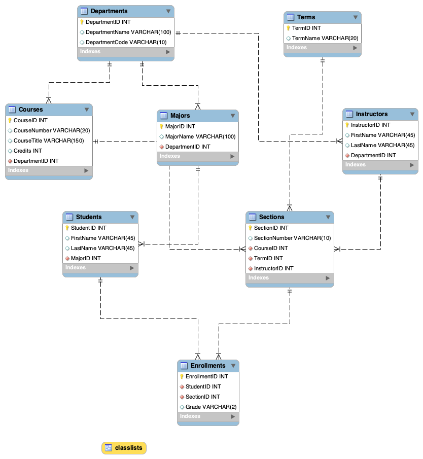

# MySQL Database Project

SQL database project developed for INFOST 410 at the University of Wisconsin–Milwaukee.

## Project Overview

This project uses MySQL to create a relational database containing information about students, courses, departments, instructors, and enrollments.

## Database Features

- Eight related database tables with primary and foreign keys
- SQL queries using JOIN, WHERE, GROUP BY, and aggregate functions
- A ClassLists view combining enrollment and course information
- Sample records for testing database queries

## EER Diagram

## SQL Source Code

[View SQL Database Script](uwm_database.sql)

## Technologies

MySQL, MySQL Workbench, SQL
